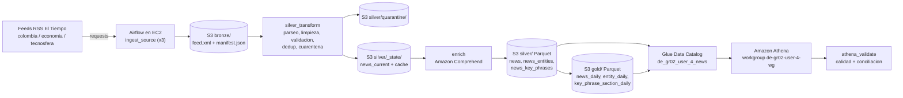

# Data Lake de noticias RSS (El Tiempo) en AWS — arquitectura medallón

Proyecto DL del curso Ingeniería de Datos (Universidad EIA). Grupo `de-gr02`, usuario `de-gr02-user-4`, región `us-east-2`.

## 1. Arquitectura



Un solo bucket privado (`de-gr02-user-4-datalake-<cuenta>`, cifrado SSE-S3, versionado, sin acceso público) con prefijos `bronze/`, `silver/`, `gold/`, `ops/`, `athena-results/`, `deploy/`.
Airflow (LocalExecutor + Postgres, Docker Compose) corre en una EC2 `t3.medium` con rol de instancia (sin claves de acceso en archivos).

## 2. Fuentes RSS seleccionadas

| source_id | Medio | Sección | URL del feed (no la página del directorio) |
|---|---|---|---|
| eltiempo_colombia | El Tiempo | Colombia | https://www.eltiempo.com/rss/colombia.xml |
| eltiempo_economia | El Tiempo | Economía | https://www.eltiempo.com/rss/economia.xml |
| eltiempo_tecnosfera | El Tiempo | Tecnosfera | https://www.eltiempo.com/rss/tecnosfera.xml |

Configuración en [config/sources.yaml](config/sources.yaml). Solo se usa el contenido del RSS (id, título, enlace, descripción, fecha); nunca se descargan las páginas.
Errores manejados: HTTP ≠ 200, respuesta vacía, feed sin `<item>`, XML malformado y error de red. Cada uno queda con estado propio en el manifiesto de Bronze y **nunca se interpreta como "sin noticias"**: la ejecución se clasifica como `complete`, `partial` o `failed`.

## 3. Capas y rutas

| Capa | Ruta | Contenido |
|---|---|---|
| Bronze | `bronze/source=<fuente>/ingestion_date=AAAA-MM-DD/run_id=<id>/` | `feed.xml` (respuesta original) y `manifest.json` (run_id, fuente, URL, fecha UTC, HTTP, SHA-256, bytes, ubicación S3, estado) |
| Silver estado | `silver/_state/news_current.parquet`, `enrichment_cache.parquet`, `batches/run_id=…/source=….json` | noticias vigentes, caché de Comprehend y registro de cada lote procesado |
| Silver cuarentena | `silver/quarantine/ingestion_date=…/run_id=…/<fuente>.parquet` | filas rechazadas con motivo y `bronze_key` |
| Silver publicado | `silver/{news,news_entities,news_key_phrases}/pub_date=AAAA-MM-DD/data.parquet` | Parquet (snappy) particionado por fecha de publicación UTC |
| Gold | `gold/{news_daily,entity_daily,key_phrase_section_daily}/pub_date=…/data.parquet` | agregados particionados por fecha |
| Operación | `ops/run_status/run_id=….json`, `ops/evidence/*.json` | estado de cada ejecución y evidencias |

Parquet elegido por ser columnar, comprimido y de esquema tipado; la partición `pub_date` permite podar particiones en Athena.

## 4. Diccionario de datos

### Silver `news` (una fila por noticia vigente)
| Columna | Tipo | Descripción |
|---|---|---|
| news_id | string | `sha256("guid:"+guid)[:32]`; si no hay GUID, `sha256("link:"+host+path)[:32]` |
| source_id, medium, section | string | fuente configurada |
| guid, link | string | valores del RSS |
| title, description | string | texto limpio (sin HTML, entidades decodificadas, espacios normalizados) |
| pub_date_raw | string | fecha original del RSS, conservada |
| pub_date_utc | timestamp | fecha normalizada a UTC |
| text_hash | string | SHA-256 de `título. descripción` (clave de la caché de Comprehend) |
| content_hash | string | SHA-256 de título, descripción, enlace y fecha (detecta cambios) |
| version | bigint | 1 + número de cambios de contenido detectados |
| first_seen_run_id, last_run_id | string | lote que la vio por primera vez / la actualizó |
| bronze_run_id, bronze_key | string | trazabilidad al archivo Bronze de origen |
| ingested_at_utc | string | fecha de ingesta del lote Bronze |
| pub_date (partición) | string | `AAAA-MM-DD` de `pub_date_utc` |

### Silver `news_entities` (una fila por entidad distinta por noticia vigente)
`news_id, language, text_hash, analyzed_at_utc, entity_type (PERSON|ORGANIZATION|LOCATION), entity_text, entity_key (minúsculas), confidence_score (máximo entre menciones), mentions, pub_date`.

### Silver `news_key_phrases` (una fila por frase clave distinta por noticia vigente)
`news_id, language, text_hash, analyzed_at_utc, key_phrase, key_phrase_norm, confidence_score, mentions, pub_date`.

### Silver `silver_quarantine`
`source_id, medium, section, bronze_run_id, bronze_key, ingested_at_utc, reject_reason, raw_item (JSON), quarantined_run_id`; particiones `ingestion_date`, `run_id`.

### Gold
| Tabla | Granularidad | Columnas |
|---|---|---|
| gold_news_daily | día × medio × sección | medium, section, news_count |
| gold_entity_daily | día × tipo × entidad | entity_type, entity_key, entity_text, news_count (noticias distintas) |
| gold_key_phrase_section_daily | día × sección × frase | section, key_phrase_norm, key_phrase, news_count |

## 5. Reglas de calidad, identificación y actualización

**Rechazo (cuarentena con motivo):** `missing_title`, `missing_link`, `invalid_link` (no http/https), `missing_pub_date`, `invalid_pub_date`, `future_pub_date` (> ahora + 1 día), `no_identifier`, `malformed_xml`. La descripción es opcional.

**Clasificación de cada registro de un lote:** `new` (id no existía), `unchanged` (mismo `content_hash` → repetido), `updated` (mismo id, distinto contenido → nueva versión vigente), `rejected` (cuarentena), `duplicate_in_batch` (mismo id dos veces en el lote: gana la última aparición) y `stale_ignored` (un lote antiguo reprocesado no revierte una versión más reciente).
Los conteos de cada lote/fuente se guardan en `silver/_state/batches/` con historial de procesamientos: así se sabe qué lote se procesó y cuándo.

**Validaciones en Athena** ([src/dl/validate.py](src/dl/validate.py)): unicidad de `news_id`, campos obligatorios, enlaces y fechas válidas, entidades/frases sin noticia, entidades/frases duplicadas, y conciliación Silver↔Gold de noticias, entidades y frases. Si alguna falla, la tarea falla y el DAG no registra éxito.

**Limitaciones del identificador:** si el medio cambia el GUID (o el enlace cuando no hay GUID) de una misma noticia, se tratará como noticia nueva; dos noticias distintas con el mismo GUID se fusionarían.

## 6. Enriquecimiento con Amazon Comprehend

Se analiza `título. descripción` por noticia: idioma dominante, entidades (PERSON, ORGANIZATION, LOCATION, score ≥ 0.5) y frases clave (score ≥ 0.5). Se guardan texto analizado, hash, idioma, fecha de análisis y scores en `enrichment_cache.parquet`.
**Sin re-llamadas:** solo se analizan `text_hash` que no estén en la caché; un cambio de solo fecha o enlace no dispara Comprehend, un cambio de título/descripción sí (y solo para esa noticia).
Casos explícitos: texto vacío (`skipped_empty_text`), texto > 4500 bytes UTF-8 (se trunca y se marca `truncated`), idioma no soportado (`skipped_unsupported_language`).
**Limitación a explicar:** Comprehend trabaja con el texto aislado del titular/resumen; sin contexto no desambigua (p. ej. "Petro" puede quedar como persona o no detectarse), mezcla tipos (organización/lugar), devuelve frases clave genéricas ("el país") y no normaliza variantes ("Bogotá" / "Bogotá D.C."). Por eso los conteos de entidades son aproximados.

## 7. Incrementalidad y recuperación

* **Estrategia de escritura (evitar duplicados parciales en Athena):** Silver y Gold se publican desde el estado vigente con **un único objeto determinista por partición** (`.../pub_date=X/data.parquet`). Un `PUT` en S3 es atómico, así que una partición contiene el archivo anterior o el nuevo, nunca mezcla ni duplicados; al final se borran particiones obsoletas. Reejecutar produce exactamente los mismos objetos.
* **Idempotencia:** reprocesar un lote ya aplicado deja todo `unchanged`; Bronze no se vuelve a escribir si el `run_id`/fuente ya está en estado `ok` (los reintentos no crean copias lógicas).
* **Fallo y reejecución:** el estado vigente se confirma antes de publicar; si cae la publicación, Athena sigue viendo la versión anterior completa y la reejecución del mismo lote publica sin pérdida ni duplicación.
* **Reproceso desde Bronze:** parámetro `reprocess_run_id` (un lote) o `rebuild_all` (todo Bronze) sin consultar los RSS; la caché evita volver a llamar a Comprehend.
* **Nueva partición:** tras escribir una fecha nueva, Athena solo la ve después de `MSCK REPAIR TABLE` (tarea `update_catalog`).
* **Ejecución parcial:** una fuente fallida marca la ejecución como `partial` (o `failed` si ninguna fuente fue ok) y queda visible en el estado de la tarea y en `ops/run_status`.

## 8. DAG `news_pipeline` ([dags/news_pipeline.py](dags/news_pipeline.py))

`validate_config → ingest_source (x3, mapeado por fuente) → collect_ingest → silver_transform → enrich → publish_silver → build_gold → update_catalog → athena_validate → register_status`

Programación `*/30 * * * *` (durante el laboratorio), `max_active_runs=1` (sin escrituras conflictivas), 2 reintentos con backoff exponencial, logs con `run_id`, fuente y tarea.
Parámetros al disparar manualmente: `reprocess_run_id`, `rebuild_all`, `fail_at` y `fail_attempts` (fallo controlado).

## 9. Despliegue, ejecución y eliminación

```bash
# Requisitos: AWS CLI configurado, Docker (solo local), Python 3.12+ para pruebas locales
# 1. Bucket, rol y workgroup (una vez)
aws s3api create-bucket --bucket de-gr02-user-4-datalake-<cuenta> --region us-east-2 --create-bucket-configuration LocationConstraint=us-east-2
aws iam create-role --role-name de-gr02-user-4-dl-ec2-role --assume-role-policy-document file://deploy/ec2-trust.json
aws iam put-role-policy --role-name de-gr02-user-4-dl-ec2-role --policy-name dl-access --policy-document file://deploy/ec2-policy.json
aws iam create-instance-profile --instance-profile-name de-gr02-user-4-dl-ec2-profile
aws iam add-role-to-instance-profile --instance-profile-name de-gr02-user-4-dl-ec2-profile --role-name de-gr02-user-4-dl-ec2-role
aws athena create-work-group --name de-gr02-user-4-wg --configuration "ResultConfiguration={OutputLocation=s3://<bucket>/athena-results/},EnforceWorkGroupConfiguration=true"
# 2. EC2 + Airflow (sube el codigo a S3, genera secretos, abre 8080 solo a tu IP)
aws s3 cp <docker-compose v2.29.7 linux-x86_64> s3://<bucket>/deploy/docker-compose   # la EC2 no alcanza github.com
bash deploy/deploy.sh <SECURITY_GROUP_ID> <TU_IP_PUBLICA>
# 3. Ejecucion local de prueba (sin Airflow)
cd src && python -m dl.cli run --run-id prueba_01
python -m dl.cli reprocess --run-id prueba_01        # reproceso desde Bronze
python -m dl.cli rebuild                             # reconstruccion total
python -m dl.scenarios {repeat|defective|incremental|modified|failure|partial|rebuild|partition}
python -m dl.queries                                 # consultas Athena + bytes escaneados
```

**Eliminación (orden):** terminar la EC2 → borrar el security group → `aws s3 rm s3://<bucket> --recursive` y eliminar todas las versiones (bucket versionado) → borrar el bucket → `aws glue delete-database --name de_gr02_user_4_news` (borra las tablas) → `aws athena delete-work-group --work-group de-gr02-user-4-wg --recursive-delete-option` → quitar el rol del instance profile, borrar el profile y el rol (`delete-role-policy` primero).

## 10. Estimación de costos (aprox., us-east-2, laboratorio de pocas horas)

| Servicio | Supuesto | Costo aprox. |
|---|---|---|
| EC2 t3.medium | ~0.04 USD/h × ~6 h | 0.25 USD |
| EBS gp3 20 GB | ~0.08 USD/GB-mes, horas | < 0.01 USD |
| S3 | < 50 MB, requests | < 0.01 USD |
| Comprehend | ~45 textos × 3 llamadas (idioma, entidades, frases; mínimo 3 unidades de 100 caracteres) | ≈ 0.05 USD |
| Athena | ~150 consultas, datos de KB (mínimo facturable 10 MB/consulta, 5 USD/TB) | < 0.01 USD |
| Glue Data Catalog | 7 tablas | 0 (capa gratuita) |
| **Total** | | **≈ 0.3–0.5 USD**; con la EC2 encendida 24/7 serían ≈ 30 USD/mes + ≈ 2 USD/mes de EBS |

Precios públicos aproximados; validar con AWS Pricing Calculator. Los costos desaparecen al eliminar los recursos.

## 11. Seguridad

Bucket privado con bloqueo de acceso público, cifrado y versionado; EC2 con rol de mínimo privilegio (S3 solo de este bucket, Comprehend, Glue, Athena); puerto 8080 abierto únicamente a la IP del operador; sin claves de acceso en código ni imágenes (`deploy/.env.example` solo lista variables); los secretos de Airflow se generan en el despliegue y viven en un archivo `.env` fuera del repositorio. Limitación documentada: `ssm:GetParameters` está denegado en la cuenta, por eso el AMI se resuelve con `describe-images`; la EC2 no tiene salida a `github.com`, por lo que el plugin de Compose se sirve desde el bucket.
