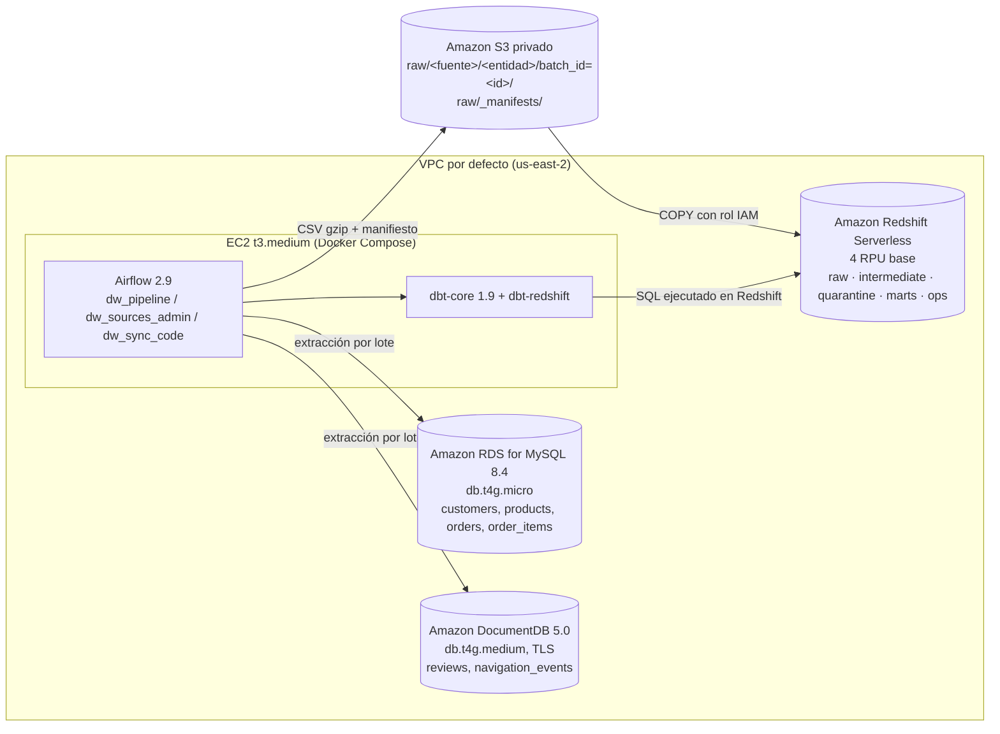

# Data Warehouse de comercio electrónico en AWS

Migración del proyecto local `DE-DW` (MySQL + MongoDB + DuckDB + dbt + Airflow en Docker) a AWS, conservando reglas de negocio, modelo dimensional, SCD tipo 2, cuarentena y pruebas. Curso Ingeniería de Datos (Universidad EIA), grupo `de-gr02`, usuario `de-gr02-user-4`, región `us-east-2`. QuickSight quedó fuera por instrucción del profesor.

## 1. Arquitectura



| Componente local (DE-DW) | Componente AWS | Notas |
|---|---|---|
| MySQL 8.4 en Docker | Amazon RDS for MySQL 8.4 (db.t4g.micro, 20 GB gp3, privada, sin backups) | mismo `schema.sql` y generador |
| MongoDB 8.0 en Docker | Amazon DocumentDB 5.0 (1 instancia db.t4g.medium, TLS obligatorio) | ver diferencias abajo |
| CSV locales por ejecución | S3 privado `raw/` con manifiesto por lote | permite reprocesar sin re-consultar las fuentes |
| DuckDB (`warehouse.duckdb`) | Amazon Redshift Serverless (4 RPU) | carga con `COPY` y rol IAM |
| dbt-duckdb | dbt-redshift (dbt corre en la EC2, el SQL corre en Redshift) | SQL adaptado |
| Airflow local | Airflow 2.9 en EC2 con Docker Compose | mismas etapas + S3 + conciliación + registro de lote |

## 2. Flujo del DAG `dw_pipeline`

`validate_connections → extract_sources → verify_s3_files → load_redshift → dbt_deps → dbt_seed → dbt_run_intermediate → dbt_run_quarantine → dbt_snapshot → dbt_run_marts → dbt_test → reconcile → register_result`

1. **Validación** de conexiones (RDS, DocumentDB, S3, Redshift) y parámetros; registra `started` en `ops.batch_log`.
2. **Extracción**: inicial = copia completa; incremental = `customers` y `products` completos (necesarios para detectar cambios SCD2) y hechos (`orders`, `order_items`, `reviews`, `navigation_events`) con llave mayor a la **marca de agua** del último lote extraído.
3. **Escritura en S3**: `s3://<bucket>/raw/<mysql|mongodb>/<entidad>/batch_id=<id>/part-000.csv.gz` + `raw/_manifests/batch_id=<id>.json` (fecha de extracción, batch ID, filas, marca de agua, SHA-256 por archivo). El manifiesto se escribe al final y funciona como *commit*. `verify_s3_files` compara el hash de cada objeto con el manifiesto.
4. **Carga a Redshift**: `COPY ... IAM_ROLE ... CSV GZIP` a una tabla temporal; luego, en una transacción, `DELETE` de las filas del mismo `_batch_id` + `INSERT` en `"raw".*` con columnas de auditoría `_batch_id`, `_extracted_at`, `_loaded_at`, `_source`. Se auditan filas del archivo vs. cargadas (`ops.load_audit`).
5. **dbt**: seeds, intermediate (staging + reglas de calidad), quarantine, snapshots (SCD2), marts, pruebas.
6. **Conciliación**: líneas y total vendido de `order_items` en RDS = `fct_sales` + `quarantine_mysql__order_items`.
7. **Registro**: `succeeded` con conteos de los marts; cualquier tarea fallida (agotados los reintentos) registra `failed` vía `on_failure_callback`.

Reintentos: 2 por tarea con backoff exponencial (30 s → máx. 5 min). `max_active_runs=1`. Logs con `batch_id` en cada tarea.

**Formato elegido: CSV comprimido con gzip.** `COPY` lo carga de forma nativa y en paralelo, se puede inspeccionar a simple vista (útil para auditar el lote) y el documento original de DocumentDB viaja completo como texto JSON en `document_json`. Parquet sería más compacto, pero exige que los tipos coincidan exactamente con la tabla destino y no aporta nada al volumen de este proyecto.

## 3. Identificación y estado de un lote

* `batch_id` explícito (parámetro) o generado desde la fecha lógica de Airflow (`b<AAAAMMDDTHHMMSS>`).
* Un lote está **extraído** cuando existe `raw/_manifests/batch_id=<id>.json`. Si se dispara de nuevo un lote extraído, **no se vuelve a consultar las fuentes**: se reutilizan sus archivos. Así funcionan el reproceso y la recuperación; los archivos nunca se sobrescriben en silencio, y además el bucket está versionado.
* `ops.batch_log` es append-only. Estados: `started` → `extracted` → `loaded` → `succeeded`, o `failed` (con tarea y error). El estado vigente de un lote es su fila más reciente; se actualiza al terminar cada etapa.
* `raw` acumula todos los lotes. Staging toma la **última versión por llave** (`row_number()` por `_extracted_at`), así un lote repetido o una reextracción de dimensiones no duplica filas.

## 4. Capas en Redshift

| Esquema | Contenido |
|---|---|
| `raw` | copia fiel de cada lote (append-only por `_batch_id`) |
| `intermediate` | `stg_*` (tipado + última versión por llave), `int_*__qa` (motivo de rechazo), `int_*__valid`, seeds y snapshots SCD2 |
| `quarantine` | filas rechazadas con `rejection_reason` y `_batch_id` de origen |
| `marts` | `dim_customer` y `dim_product` (SCD2), `dim_date`, `dim_geography`, `dim_sales_channel`, `dim_event_type`, `fct_sales`, `fct_reviews`, `fct_navigation_events` |
| `ops` | `batch_log`, `load_audit` |

El modelo dimensional (constelación de hechos), las llaves subrogadas (`dbt_utils.generate_surrogate_key`), las reglas de calidad, la resolución *point-in-time* contra SCD2, la ventana de reproceso de 7 días y las pruebas son los del proyecto local.

## 5. Adaptaciones de SQL DuckDB → Redshift

| DuckDB (local) | Redshift (AWS) | Dónde |
|---|---|---|
| `select * exclude (rejection_reason)` | `dbt_utils.star(..., except=[...])` | `int_*__valid` |
| `json_extract_string(doc, '$.a.b')` | `json_extract_path_text(doc, 'a', 'b', true)` | `stg_mongodb__reviews` |
| `timezone('America/Bogota', ts)` | `convert_timezone('UTC','America/Bogota', ts::timestamp)` (macro `to_business_time`) | hechos de MongoDB y pruebas |
| `a is distinct from b` | macro `is_distinct` (comparación null-safe) | macro incremental y pruebas |
| `extract(isodow from d)` | macro `iso_dow` sobre `date_part(dow, d)` | `dim_date` |
| `datediff('day', a, b)` | `dbt.datediff` | prueba de rango de fechas |
| `EXISTS` correlacionado en el filtro incremental | `IN` no correlacionado contra el CTE de candidatas | `incremental_candidate_filter` |
| alias de tabla `date` | `dates` | hechos y pruebas |
| esquema `raw` | `"raw"` entre comillas en SQL manual (RAW es palabra reservada de Redshift; dbt ya cita) | ingesta y consultas |
| tipos `VARCHAR`, `JSON` | `VARCHAR(n)`, documento como `VARCHAR(65535)` | tablas raw |
| un solo escritor (lock de archivo DuckDB) | sin lock; concurrencia controlada con `max_active_runs=1` | Airflow |
| `read_csv` desde disco | `COPY` desde S3 con rol IAM | ingesta |

## 6. MongoDB vs. DocumentDB

| Aspecto | MongoDB local | DocumentDB 5.0 | Impacto |
|---|---|---|---|
| Conexión | sin TLS | TLS obligatorio con `global-bundle.pem`, `replicaSet=rs0` | URI en el contenedor |
| `retryWrites` | soportado | **no soportado** → `retryWrites=false` | URI |
| Acceso de red | puerto local | solo dentro de la VPC | generación de datos vía DAG `dw_sources_admin` en la EC2 |
| Validador `$jsonSchema` y `bypassDocumentValidation` | sí | sí en 5.0 (verificado; el código tiene fallback si el motor lo rechazara) | ninguno |
| Compatibilidad | MongoDB 8.0 | API compatible con MongoDB 5.0; el driver advierte que es DocumentDB | sin operadores fuera del API compatible |
| Costo | gratis | instancia mínima db.t4g.medium por hora | se borra al terminar |

## 7. Escenarios evidenciados

Resultados en `docs/evidence/` (JSON de Airflow y de Redshift) y capturas en `docs/screenshots/`.

| Escenario | Cómo se ejecuta | Resultado esperado |
|---|---|---|
| Carga inicial | `dw_pipeline` con `batch_id=batch_001_initial`, `mode=initial` | marts poblados, pruebas y conciliación OK |
| Registros defectuosos | generador con `--bad-records 2` | rechazos en `quarantine.*` con motivo y `_batch_id` |
| Repetición de lote exitoso | mismo `batch_id` otra vez | conteos idénticos; sin nuevas versiones SCD2 |
| Nuevo lote incremental | `dw_sources_admin action=append_batch` + nuevo `batch_id` | solo filas nuevas (marca de agua) |
| Cambio historizado | `action=simulate_changes` + nuevo lote | nueva versión SCD2 y cierre (`valid_to`) de la anterior |
| Fallo controlado y reejecución | `fail_at=load_redshift fail_attempts=5`, luego mismo `batch_id` sin fallo | `failed` registrado; reejecución sin pérdida ni duplicados |
| Fallo transitorio | `fail_at=dbt_run_marts fail_attempts=1` | se recupera con el reintento automático |

## 8. Despliegue, ejecución y eliminación

```bash
cd datawarehouse
bash deploy/create_infra.sh <TU_IP_PUBLICA>   # S3, SGs, RDS, DocumentDB, rol IAM, Redshift Serverless
bash deploy/deploy_ec2.sh                     # EC2 + Airflow + dbt (código y .env desde S3 privado)
# Airflow: http://<ip-ec2>:8080 (usuario admin; contraseña en .build/dw.env, fuera del repo)
# 1) dw_sources_admin {"action":"init"}            2) dw_pipeline {"batch_id":"batch_001_initial","mode":"initial"}
# 3) dw_sources_admin {"action":"append_batch","batch_number":1}  4) dw_pipeline {"batch_id":"batch_002_incr"}
# Actualizar código sin SSH: subir .build/dw-app.tgz a s3://<bucket>/deploy/ y disparar dw_sync_code
powershell tools/dw_scenarios.ps1 -AirflowIp <ip>   # todos los escenarios con evidencias
```

`deploy/.env.example` lista las variables necesarias; los valores reales se generan en `.build/dw.env` (ignorado por git) y viajan a la EC2 por S3 privado.

**Eliminación (orden):** terminar la EC2 → `delete-workgroup` y `delete-namespace` de Redshift Serverless (y su límite de uso) → `delete-db-instance` + `delete-db-cluster --skip-final-snapshot` de DocumentDB → `delete-db-instance --skip-final-snapshot` de RDS → subnet group de DocumentDB → security groups → vaciar el bucket (todas las versiones) y borrarlo → roles e instance profile. El script `deploy/destroy_infra.sh` lo hace en ese orden.

## 9. Costos estimados (us-east-2, laboratorio de pocas horas)

| Servicio | Supuesto | Costo aprox. |
|---|---|---|
| Redshift Serverless | 4 RPU × ~0.375 USD/RPU-h, solo mientras ejecuta consultas (~1 h efectiva) | ≈ 1.5 USD |
| DocumentDB db.t4g.medium | ~0.08 USD/h × ~3 h + I/O mínima | ≈ 0.3 USD |
| RDS db.t4g.micro | ~0.016 USD/h × ~3 h + 20 GB | ≈ 0.06 USD |
| EC2 t3.medium | ~0.04 USD/h × ~3 h | ≈ 0.13 USD |
| S3 | pocos MB | < 0.01 USD |
| **Total** | | **≈ 2 USD**; dejarlo encendido un mes costaría ≈ 140 USD, sobre todo por DocumentDB, por eso se borra al terminar |

Control de costos: límite de uso de Redshift Serverless de 6 RPU-hora diarios con acción `deactivate`, instancias mínimas sin Multi-AZ ni backups, y eliminación inmediata al terminar.

## 10. Seguridad

* RDS, DocumentDB y Redshift sin acceso público: su security group solo admite tráfico desde el SG de la EC2 (3306, 27017, 5439).
* Airflow (8080) abierto solo a la IP del operador.
* Bucket privado con bloqueo de acceso público, cifrado SSE-S3 y versionado.
* Redshift lee S3 con un rol IAM de solo lectura sobre el bucket del DW; la EC2 tiene un rol limitado a ese bucket.
* Sin secretos en el repositorio: las contraseñas se generan en el despliegue y van en `.env` fuera de git; TLS obligatorio hacia DocumentDB y `sslmode=require` hacia Redshift.
* Consultas de evidencia con la Redshift Data API usando la identidad IAM (`IAM:de-gr02-user-4`) con permisos `GRANT SELECT` de solo lectura.
